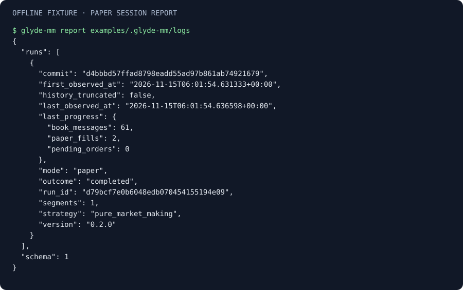

# A successful offline paper-session report

This sample runs the real replay CLI, strategy, simulator, risk boundary and report
reader without network access or credentials. The committed public-book recording
is a **synthetic test fixture**, not historical BTC prices. Its deliberate price
moves demonstrate the workflow; the simulated profit is not a performance claim.
[Fixture provenance and exact observations](../examples/recordings/README.md).

Use a checkout with the current package installed. The released v0.2.0 wheel prints
a replay summary but predates replay-to-log support added here; install this source
checkout to reproduce this example. Live/paper streaming run reports are unchanged.

## 1. Replay one recorded minute

From the repository root:

```sh
glyde-mm replay --config examples/paper-session.yaml \
  --book-file examples/recordings/paper-session.jsonl --minutes 1
```

Actual output from this sample:

```text
PAPER REPLAY | inventory=0.00 | simulated_pnl=+0.04 USDC | fills=2 | risk_stop=none | simulated_seconds=60
Quotes cancelled. Simulation excludes fees, funding and queue priority.
```

The sample begins flat with simulated funds, buys and sells 0.01 units, ends flat,
and cancels its quotes. Fees, funding, liquidation and real queue priority are
excluded. No HTTP, WebSocket, private-account lookup or signing wallet is used.
Existing persistent trading-risk state is not read or reset; replay risk remains
in memory. Only diagnostic logs are written under `examples/.glyde-mm/logs`.

## 2. Summarize that session

```sh
glyde-mm report examples/.glyde-mm/logs
```

This is the actual report from the same offline sample run. Build commit, run ID
and timestamps vary on your installation. If you replay again, the parent logs
directory contains multiple runs; select one `run-<id>` directory to isolate it.

```json
{
  "runs": [
    {
      "commit": "d4bbbd57ffad8798eadd55ad97b861ab74921679",
      "first_observed_at": "2026-11-15T06:01:54.631333+00:00",
      "history_truncated": false,
      "last_observed_at": "2026-11-15T06:01:54.636598+00:00",
      "last_progress": {
        "book_messages": 61,
        "paper_fills": 2,
        "pending_orders": 0
      },
      "mode": "paper",
      "outcome": "completed",
      "run_id": "d79bcf7e0b6048edb070454155194e09",
      "segments": 1,
      "strategy": "pure_market_making",
      "version": "0.2.0"
    }
  ],
  "schema": 1
}
```



## What success means

- `mode: paper` identifies simulation. `outcome: completed` means the replay and
  cleanup returned normally; it is not proof of live trading authority.
- `book_messages: 61` and `paper_fills: 2` match this fixture. `pending_orders: 0`
  is observed from the simulator after cleanup, not inferred from the exit code.
- `history_truncated: false` means no earlier diagnostic segments rotated away.
  Report timestamps are actual execution time; the replay's 60 seconds use a
  virtual market clock and do not take a minute to execute.
- A risk refusal reports `risk_stop`; another execution or cleanup error reports
  `error`. An interrupted process may leave `incomplete`. None should be presented
  as this successful example.

The report contains no keys, balances, addresses or order bodies. Review it before
sharing. For your own market experiment, capture real public books first using
[`record`](replay.md); this fixture cannot predict live profitability.
